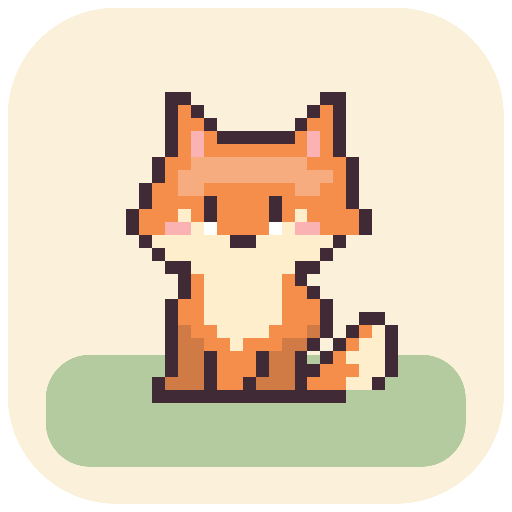
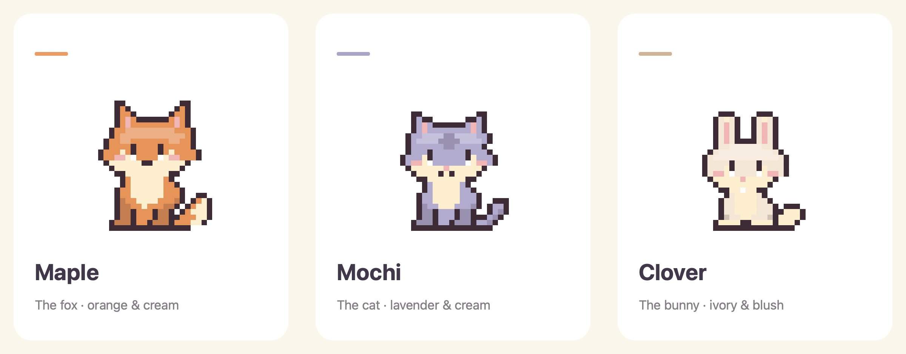
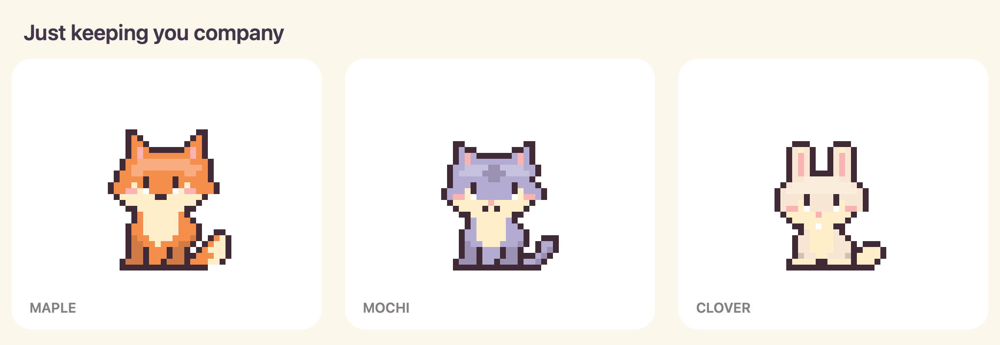
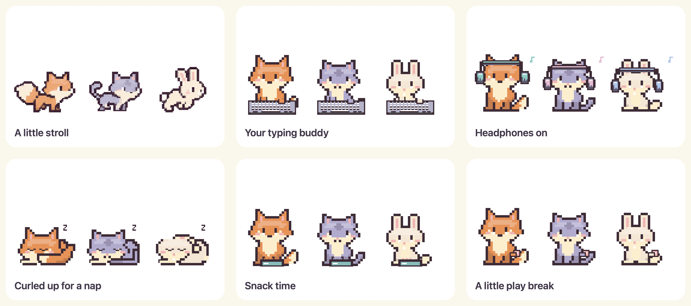

<p align="center">
  
</p>

<p align="center"></p>

<h1 align="center">Old MacDonald’s Desktop Farm</h1>

<p align="center">
  A cozy little corner of your Mac.<br>
  Three pixel pals that walk, nap, type along and keep you company.
</p>

<p align="center">
  <a href="https://github.com/oatakk/old-macdonalds-desktop-farm/releases/tag/v0.4.2"><strong>Download for Apple Silicon</strong></a>
  &nbsp; · &nbsp;
  <a href="#get-started">Getting started</a>
  &nbsp; · &nbsp;
  <a href="#build-it-yourself">Build from source</a>
  &nbsp; · &nbsp;
  <a href="https://github.com/oatakk/old-macdonalds-desktop-farm/issues">Feedback & ideas</a>
</p>

<p align="center">
  <a href="https://github.com/oatakk/old-macdonalds-desktop-farm/actions/workflows/build.yml"></a>
  
  
  <a href="LICENSE"></a>
</p>

---

## Meet your new desk mates

An orange fox, a lavender cat and a little ivory bunny. Choose a favorite from the menu bar or control panel, then give them a little space on your desktop.



| Pal | Look | A little detail |
| :--- | :--- | :--- |
| **Maple · Fox** | Orange fur, cream cheeks and a big cream-tipped tail | Curls up behind that fluffy tail for a nap. |
| **Mochi · Cat** | Soft lavender, cream muzzle and a curled tail | Occasionally brings a paw up to wash a cheek. |
| **Clover · Bunny** | Ivory fur, pink ears and a tiny round tail | Hops around and settles down with folded ears. |

## A little life on your desktop

A tiny stroll between tasks. A keyboard when you type. Headphones when audio is playing. A curled-up nap when you pause.



The pals stay above your windows and live in the menu bar, with no Dock icon. Drag yours somewhere comfortable. Transparent space around the character lets clicks pass through to the app underneath.



> The character gallery and GIF are rendered by the app’s own drawing code. The control-panel images below are captures of the running macOS app.

## Your companion, your pace

Care is a choice. You can keep a pal on screen without managing needs, or switch on a little pocket-pet nostalgia.

<table>
  <tr>
    <th width="50%">Companion mode</th>
    <th width="50%">Virtual pet mode</th>
  </tr>
  <tr>
    <td valign="top">
      <p>Just good company. Your pal wanders, naps and reacts to typing and audio. No feeding routine required.</p>
      
    </td>
    <td valign="top">
      <p>Food, Joy and Rest in a retro green panel. Feed, cuddle, play or let your pal sleep — whenever you feel like it.</p>
      
    </td>
  </tr>
</table>

Each animal has its own saved needs. Closing the app pauses care: there is no offline decay, illness or death mechanic.

| Action | What happens |
| :--- | :--- |
| **Feed** | A little bowl appears, food recedes, and Food increases. |
| **Cuddle** | A heart reaction and a boost to Joy. |
| **Play** | A bouncing paw-ball; Joy increases while Food and Rest decrease a little. |
| **Sleep / Wake** | A curled resting pose; sleeping restores Rest. |

## Get started

### 1. Bring the farm home

**[Download the macOS app →](https://github.com/oatakk/old-macdonalds-desktop-farm/releases/download/v0.4.2/Old-MacDonalds-Desktop-Farm-macOS.zip)**

Unzip the download and move **Old MacDonalds Desktop Farm.app** into **Applications**. Open it and look for the monochrome fox icon in your menu bar.

| Requirement | Current release |
| :--- | :--- |
| macOS | **14.2 or newer** |
| Download architecture | **Apple Silicon** |
| Account or subscription | None |
| Runtime dependencies | None |
| App language | English |

### First launch: macOS verification warning

The current download is locally signed, **not signed with an Apple Developer ID or notarized by Apple**. macOS may show **“Apple could not verify…”** and block the first launch.

If you trust the download from this repository, you can approve this app individually:

1. In the warning dialog, click **Done**.
2. Open **System Settings → Privacy & Security**.
3. Scroll to **Security**, find **Old MacDonalds Desktop Farm**, and click **Open Anyway**. This option appears after you try to open the app.
4. Authenticate if prompted, then click **Open** in the confirmation dialog.

You only need to approve this app; leave your Mac’s general security settings enabled. See [Apple’s guide to opening apps safely](https://support.apple.com/en-us/102445).

The app runs from the **fox icon in the menu bar** and does not appear in the Dock automatically. Move the `.app` into **Applications** so you can find and launch it there.

The native source build targets the architecture of the Mac used to compile it; Intel builds have not been validated.

### 2. Pick a pal

Choose **Maple**, **Mochi** or **Clover** in the control panel. Select **Small**, **Medium** or **Large** and drag your pal into place. Position, size and the selected animal are saved.

### 3. Make yourself comfortable

Leave **Virtual pet mode** off for a carefree companion. Turn it on for snacks, cuddles and the retro needs panel. Disable **Let my pal wander** if you prefer a pal that stays put.

## The little controls

| Gesture or control | Result |
| :--- | :--- |
| **Click the pal** | A head scratch and a heart; adds a little Joy in care mode. |
| **Drag the pal** | Move it around your desktop. |
| **Double-click** | Open the control panel. |
| **Right-click** | Open its menu. |
| **Menu-bar fox icon** | Change pal, open controls, sleep, hide or quit. |
| **Bring here** | Bring the pal back to the main display. |
| **Hover** | No reaction; the pal carries on. |

Manual sleep takes priority over typing and audio. Clicking or dragging a sleeping pal wakes it.

## Private by design

No account. No ads. No telemetry. No network requests from the app.

The app reads only what its reactions need:

| Signal | Purpose | What it does not capture |
| :--- | :--- | :--- |
| Cursor position | Dragging, positioning and transparent click-through | Screenshots or browsing activity |
| Aggregate keyboard idle time | Show the typing animation | Keys, typed text or documents |
| Core Audio output-stream activity | Put headphones on while audio is active | Audio samples, track titles or microphone recordings |

Preferences and per-pet needs stay locally on your Mac. Image generation is used during artwork creation only; running the app requires no AI service or API key.

## Build it yourself

Requires Apple’s Command Line Tools and Python 3 for the build helper.

```sh
git clone https://github.com/oatakk/old-macdonalds-desktop-farm.git
cd old-macdonalds-desktop-farm
bash scripts/build.sh
```

The locally signed, distributable ZIP is written to:

```text
.build/Old-MacDonalds-Desktop-Farm-macOS.zip
```

There are no third-party Swift packages or JavaScript runtimes to install.

### Run the checks

```sh
python3 scripts/test.py
```

The tests compile the current production code and use isolated preferences. They cover rendering, changing animation frames, care actions, independent saved needs, sleep priorities, scaling and alpha hit-testing. The latest local regression run passed **251 checks**. GitHub Actions builds and tests the project on macOS.

Passing checks do not measure whether an animation looks natural, or establish compatibility with every media player.

## A few honest limitations

- **Audio detection follows active streams.** Silent video is not detected; a paused player that keeps its stream open can leave the headphones visible.
- **The headphone lights are decorative.** They are not actual beat detection.
- **Play happens in place.** The ball animation is not world-space fetch.
- **Some pose transitions are immediate.** Walking art has slightly richer shading than the native idle sprites.
- **More real-world testing is welcome.** Multi-monitor layouts, prolonged battery usage, Intel builds and more media players need coverage.

## Help the farm grow

Found an odd pose or an interaction that feels off? [Open an issue](https://github.com/oatakk/old-macdonalds-desktop-farm/issues) with the pal, action, macOS version and a screenshot or short recording. For audio issues, include the player and output device.

Small, focused contributions are especially useful: clearer animation transitions, accessibility, multi-monitor fixes and reproducible bug reports. Please keep care optional and preserve the offline experience.

## Artwork & license

Native poses, accessories and UI are drawn with Swift/AppKit. The dedicated walking sprites were created with OpenAI ImageGen using the original characters as reference, then prepared as aligned transparent frames. See [ARTWORK.md](ARTWORK.md) for provenance.

This project is available under the [MIT License](LICENSE).

<p align="center"><strong>A little farm. A quieter workday.</strong></p>
