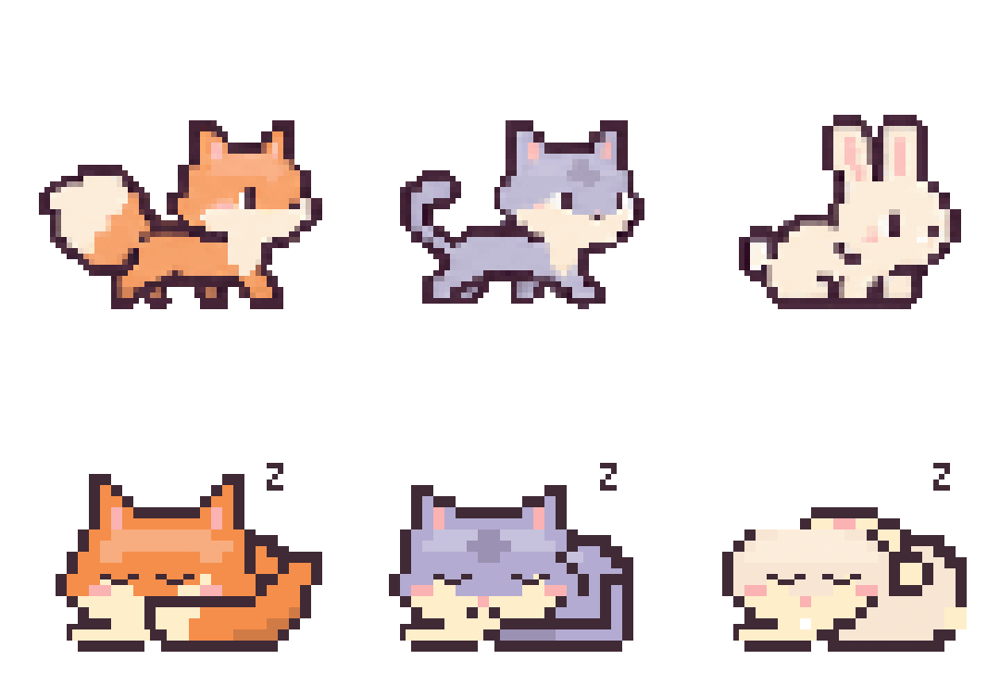

# Old MacDonald’s Desktop Farm 🦊🐱🐰

A tiny pixel farm for your Mac. No chores required.



Maple the fox, Mochi the cat, and Clover the bunny hang out on your desktop, walk around, curl up for a nap, tap a tiny keyboard while you type, and wear headphones when audio is playing.

## Two ways to keep company

**Companion mode:** let your pal wander, nap, and keep you company. No feeding or care required.

**Virtual pet mode:** an optional little throwback to pocket pets. Feed, cuddle, play, and rest to replenish Food, Joy, and Rest. Each animal has its own saved needs. Needs pause when you close the app.

## Little details

- Three pixel pals with six-frame walking/hopping cycles.
- Curled-up sleeping poses and blinking eyes.
- A tiny keyboard and animated headphones.
- Food bowls, a bouncing paw-ball, and heart reactions.
- Click to pet, drag to move, double-click to open the control panel.
- Hovering does not change the pal’s behavior.
- Small, Medium, and Large sizes; saved position and preferences.
- Transparent pixels let clicks pass through to the app underneath.
- Menu-bar controls. No Dock icon, accounts, ads, or network requests.

## Run

Download the macOS ZIP from **Releases**, unzip it, and move the app into Applications. Open it and look for its animal icon in the menu bar. Quit from the control panel or menu bar.

The current binary targets Apple Silicon. macOS 14.2 or newer is required. The app is locally signed, not Apple-notarized; macOS may require approval in Privacy & Security before allowing it to open.

## Build from source

Install Apple’s Command Line Tools, then run:

```sh
./scripts/build.sh
open '.build/Old MacDonalds Desktop Farm.app'
```

The build uses your Mac’s native architecture and has no third-party runtime dependencies.

## Tests

```sh
python3 scripts/test.py
```

Tests compile the current production implementation with isolated preference suites. They cover pose rendering, animation changes, care actions, saved needs, sleep priorities, sizing, and alpha hit-testing. Passing checks do not establish subjective animation quality or compatibility with every media player.

## Privacy

Everything stays on your Mac. The app reads cursor position, aggregate keyboard idle time, and whether Core Audio output streams are active. It does not capture typed text, record audio, inspect media titles, or send data anywhere. No microphone or screen-recording capture is used.

## Current limitations

- Silent video is not detected. An app keeping an audio stream open may leave headphones visible while paused.
- Headphone lights and music notes are decorative, not beat detection.
- Play is an in-place ball animation, not world-space fetch.
- Idle/walking pose transitions are immediate.
- Multi-monitor behavior, long-running battery usage, and broad player compatibility need more testing.
- Walking art has slightly richer shading than the native idle sprites.

## Artwork and license

Native pixel poses and UI are drawn in Swift/AppKit. Walking sprites were generated with OpenAI ImageGen using the original characters as a reference, then sliced into aligned, transparent frames. See [ARTWORK.md](ARTWORK.md).

MIT licensed. Contributions and thoughtful animation improvements are welcome.
